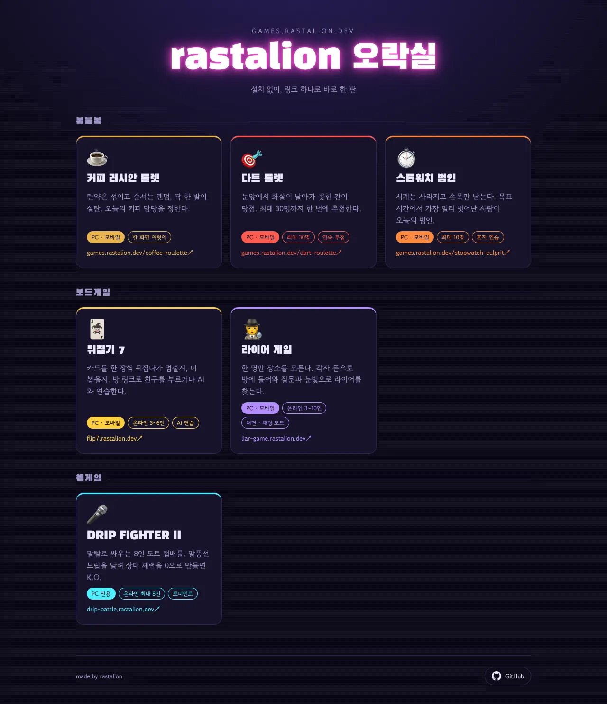
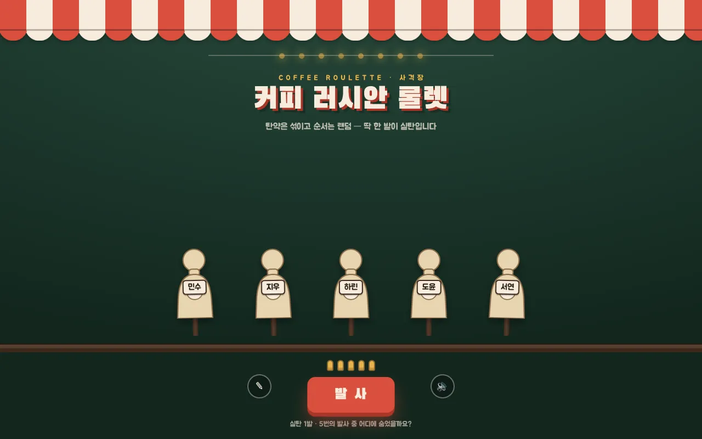
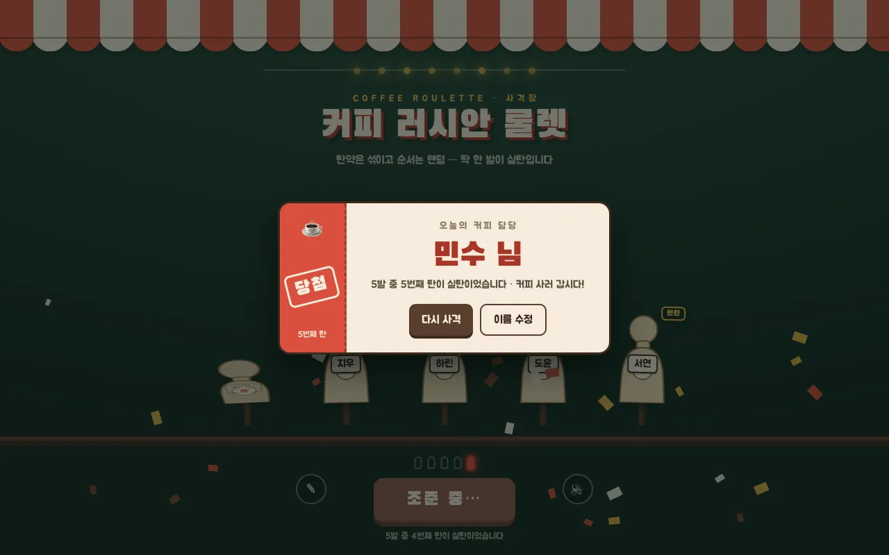
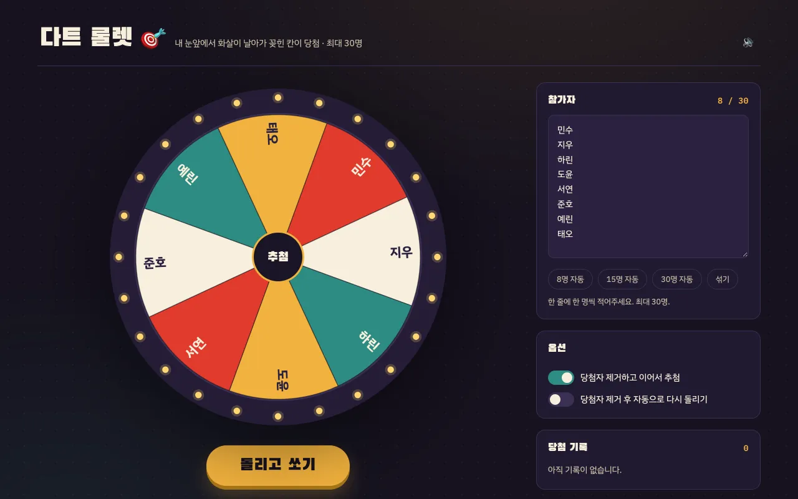
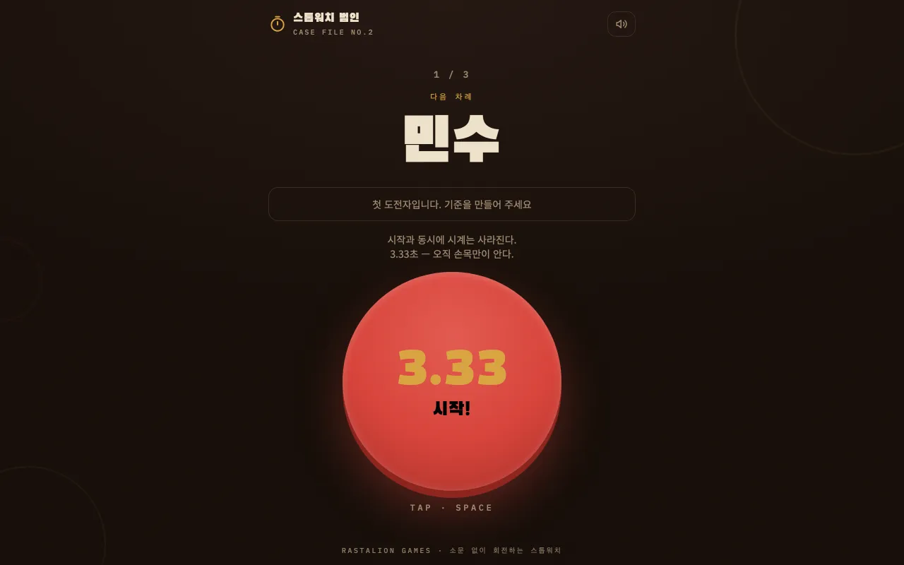
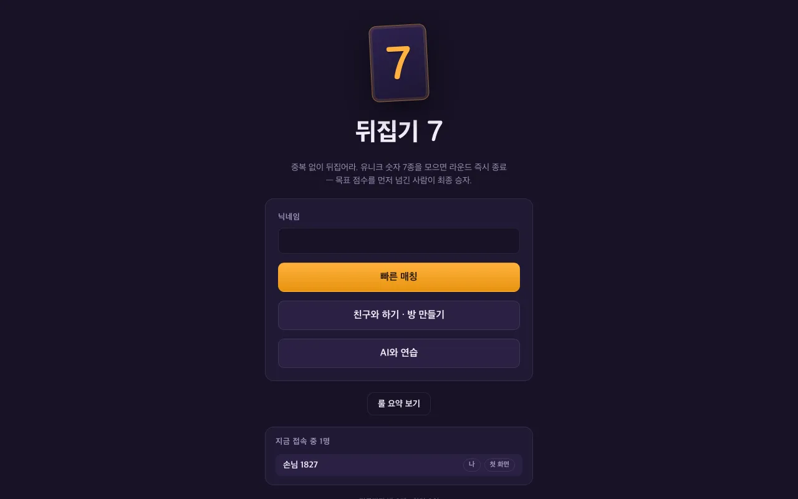
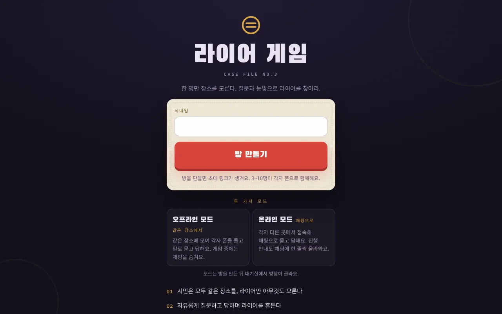

직접 만든 웹게임을 한곳에 모은 대문 페이지 ‘rastalion 오락실’을 [games.rastalion.dev](https://games.rastalion.dev)에 열었습니다. 지금은 게임 여섯 개가 복불복·보드게임·웹게임 세 칸에 나뉘어 있습니다. 복불복 세 개는 한 화면 앞에 여럿이 모여 커피 당번이나 발표 순서를 정하는 게임이고, 보드게임 두 개는 각자 폰으로 같은 방에 들어와 함께 하는 온라인 게임입니다. 웹게임 칸에는 앞서 소개한 도트 랩배틀 DRIP FIGHTER II가 있습니다. 모두 설치나 회원가입 없이 브라우저에서 링크만 열면 됩니다. 대문의 카드를 누르면 게임이 새 창으로 열립니다.

## 복불복: 한 화면 앞에 모여서 정하는 게임 셋

복불복 칸의 세 게임은 화면 하나를 여럿이 같이 봅니다. 이름 입력부터 결과 확인까지 한 기기에서 끝나며 게임 진행에 서버를 쓰지 않습니다. 세 게임 모두 PC와 모바일에서 열리고 효과음은 끌 수 있습니다.

### 커피 러시안 룰렛

3~10명이 참가하고 한 발만 실탄인 사격으로 오늘의 커피 담당을 정합니다. 이름은 하나씩 넣어도 되고 쉼표나 줄바꿈으로 구분해 한 번에 붙여 넣어도 됩니다. 같은 이름은 두 번 등록되지 않습니다.

‘사격 시작’을 누르면 사격 순서가 무작위로 섞이고, 참가자 수만큼 탄이 장전되며 그 가운데 한 발만 실탄입니다. ‘발사’를 누를 때마다 다음 사람의 표적을 한 발씩 쏩니다. 빈탄이면 표적에 ‘빈탄’ 도장이 찍히고 실탄이 나오면 그 표적의 주인이 오늘의 커피 담당입니다. 사격 순서와 실탄 위치는 브라우저의 암호학적 난수(`crypto.getRandomValues`)로 정합니다. ‘다시 사격’을 누르면 둘 다 새로 섞습니다.

### 다트 룰렛

참가자를 칸으로 나눈 원판을 돌리고 다트를 던져 꽂힌 칸의 사람을 뽑습니다. 2명부터 30명까지 넣을 수 있고 명단은 한 줄에 한 명씩 적습니다. ‘8명 자동’·‘15명 자동’·‘30명 자동’을 누르면 ‘1번’부터 그 수만큼 번호로 채우고 ‘섞기’는 명단 순서를 섞습니다.

‘돌리고 쏘기’를 누르면 원판이 돌기 시작하고, 다트가 화면 아래에서 날아와 도는 원판에 꽂힌 뒤 원판이 천천히 멈춥니다. 당첨자는 원판이 돌기 시작할 때 무작위로 정해지고 다트가 그 사람의 칸에 꽂히도록 회전량을 맞춥니다. 결과 창에서 당첨자를 명단에서 빼고 다시 돌리거나 명단을 그대로 두고 다시 돌릴 수 있습니다. ‘당첨자 제거하고 이어서 추첨’은 기본으로 켜져 있습니다. 여기에 ‘당첨자 제거 후 자동으로 다시 돌리기’까지 켜면 결과가 나온 뒤 당첨자를 빼고 저절로 다음 추첨을 이어 가므로 순서 정하기에 쓸 수 있습니다. 뽑힌 사람은 ‘당첨 기록’에 차례대로 쌓이고 이 기록은 페이지를 새로 고치면 사라집니다.

### 스톱워치 범인

목표 시간에 맞춰 스톱워치를 멈추는데, 시작하는 순간 시계가 사라집니다. 2~10명이 등록한 순서대로 한 번씩 도전하고 목표 시간에서 가장 멀리 벗어난 사람이 그 라운드의 범인이 됩니다. 목표 시간은 2.00·3.33·5.00·10.00초 가운데 고르거나 0.5초에서 60초 사이로 직접 넣습니다. 기본값은 3.33초입니다.

차례가 오면 ‘시작!’을 누르고 감으로 ‘멈춤!’을 누릅니다. 화면을 탭해도 되고 Space나 Enter 키를 눌러도 됩니다. 시계가 가려진 동안에는 ‘?’ 표시가 불규칙하게 깜빡여서 박자를 세기 어렵습니다. 멈추면 목표보다 몇 초 이르거나 늦었는지가 나오고, 오차가 30ms 이하면 ‘인간 스톱워치’, 500ms를 넘으면 ‘프리미엄 범인’처럼 오차 크기에 따라 여섯 단계 도장이 찍힙니다. 범인은 오차의 절댓값이 가장 큰 사람이고 같은 값이 나오면 공동 범인입니다. 라운드는 ‘다음 라운드’를 누르는 만큼 이어지고 사람마다 범인이 된 횟수를 셉니다.

혼자라면 ‘감각 연습’에서 시계가 보이는 채로 목표 시간을 익힐 수 있고 이 기록은 범인 집계에 들어가지 않습니다. 입력한 명단과 목표 시간은 브라우저에 저장되어 다음에 열어도 남아 있습니다.

## 보드게임: 각자 폰으로 같은 방에 들어오는 게임 둘

보드게임 칸의 두 게임은 각자 자기 기기로 같은 방에 들어옵니다. 방을 만들면 `/r/방코드` 형태의 초대 링크가 생기고 로그인 없이 닉네임만 정하면 입장합니다. 게임 진행은 서버가 맡고 다른 사람에게 보이면 안 되는 정보는 화면에 보내지 않습니다.

### 뒤집기 7

보드게임 Flip 7을 바탕으로 만든 비공식 팬메이드 온라인 버전입니다. 카드를 한 장씩 뒤집다가 멈출지 더 뽑을지를 고르는 게임으로, 3~6명이 한 방에서 합니다. 방장이 목표 점수(100·200·300점)와 클래식·매운맛 두 버전 가운데 하나를 고릅니다. 빠른 매칭은 3명이 모이면 10초 뒤에, 6명이 차면 바로 시작합니다. 혼자서는 AI 2~5명과 연습할 수 있고 AI 난이도는 쉬움·보통·어려움 가운데 고릅니다. 연결이 끊겨도 30초 안에 다시 들어오면 같은 자리로 돌아옵니다.

### 라이어 게임

참가자 가운데 한 명만 이번 장소를 모르는 상태에서 질문을 주고받아 그 한 명, 라이어를 찾는 게임입니다. 3~10명이 참가하고 접속한 사람이 3명 이상이면 방장이 시작합니다. 시민의 화면에는 장소와 역할 목록이, 라이어의 화면에는 ‘라이어’ 도장이 뜹니다.

모드는 두 가지입니다. 오프라인 모드는 같은 장소에 모여 질문을 말로 주고받고, 온라인 모드는 각자 다른 곳에서 채팅으로 묻고 답합니다. 질문 시간은 없음·5분·8분 가운데 고르고 기본은 8분입니다. 시간이 다 되거나 과반이 투표를 요청하면 60초 동안 비밀 투표를 하고 누가 누구를 지목했는지는 끝까지 공개하지 않습니다. 라이어로 지목된 사람에게는 장소를 맞힐 기회가 60초 동안 한 번 더 주어집니다. 장소는 20곳 가운데에서 뽑고 최근 세 라운드에 나온 곳은 피합니다.

## 웹게임: DRIP FIGHTER II

웹게임 칸에는 친구끼리 드립 한 줄씩 주고받는 도트 랩배틀 [DRIP FIGHTER II](/products/drip-fighter-2-web-game/)가 있습니다. 한 방에 최대 8명이 모여 1:1 토너먼트를 하고 AI가 드립마다 데미지를 매깁니다. 오락실 게임 가운데 이 게임만 PC 전용입니다. 자세한 규칙은 소개 글에 정리해 두었습니다.

## 게임 한눈에 보기

| 게임 | 분류 | 인원 | 하는 방식 |
| --- | --- | --- | --- |
| 커피 러시안 룰렛 | 복불복 | 3~10명 | 한 화면 |
| 다트 룰렛 | 복불복 | 2~30명 | 한 화면, 연속 추첨 |
| 스톱워치 범인 | 복불복 | 2~10명 | 한 화면, 혼자 연습 |
| 뒤집기 7 | 보드게임 | 3~6명 | 각자 기기, AI 연습 |
| 라이어 게임 | 보드게임 | 3~10명 | 각자 기기, 대면·채팅 모드 |
| DRIP FIGHTER II | 웹게임 | 최대 8명 | 각자 기기, PC 전용 |

## 오락실은 이렇게 돌아갑니다

대문 페이지와 복불복 세 게임은 각각 HTML 파일 하나입니다. nginx 컨테이너 하나가 이 파일을 그대로 내보내고 주소에 `.html`을 붙이지 않아도 열립니다(`/coffee-roulette`). 뒤집기 7·라이어 게임·DRIP FIGHTER II는 각자 서버를 갖춘 별도 서비스이고 대문에는 그 주소로 가는 카드만 있습니다.

배포는 GitHub Actions가 맡습니다. `main` 브랜치에 변경이 머지되면 먼저 대문의 내부 링크와 링크 미리보기 이미지가 가리키는 파일이 실제로 있는지 검사합니다. 통과하면 컨테이너 이미지를 빌드해 GitHub Container Registry(GHCR)에 올립니다. NAS에서 도는 self-hosted 러너가 새 이미지로 컨테이너를 다시 띄우고 헬스 체크가 `healthy`가 될 때까지 확인합니다. 도메인과 TLS 인증서는 앞단의 Nginx Proxy Manager가 처리합니다. 카드 하나를 추가하는 작업도 이 흐름을 그대로 거칩니다.



## 생각: 취미 삼아 AI로 만드는 웹게임 모음입니다

여기서부터는 게임을 만든 사람으로서 하는 개인적인 이야기입니다.

오락실은 취미 삼아 AI로 하나씩 만들고 있는 웹게임을 모아 둔 곳입니다. 뒤집기 7은 간단하게 할 수 있는 좋아하는 보드게임을 온라인에서도 할 수 있게 만들어 보고 싶어서 만들었습니다. 상업적으로 이용할 생각은 없으니 팬메이드 웹게임으로 봐 주시면 좋겠습니다. 새 게임을 만들면 대문에 카드를 하나씩 더 붙여 나가겠습니다.
